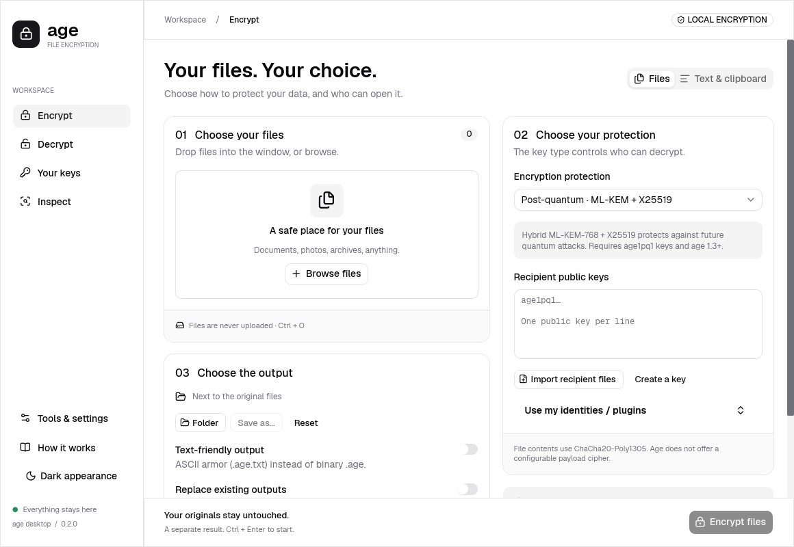

# age desktop

A native Rust desktop companion for [age](https://github.com/FiloSottile/age), with actual **shadcn-iced** components, Geist typography, Lucide icons, light/dark themes, and CPU/GPU rendering. The application uses the Rust `age` library from [rage](https://github.com/str4d/rage) directly.



[Dark theme screenshot](docs/screenshots/dark.png)

## Run

On Windows, open `dist/age-desktop.exe` after building or use the portable ZIP. There is no installer, account, service, browser runtime, or separate age CLI requirement.

```powershell
cargo run --release --locked
cargo run --release --locked -- --renderer cpu
cargo run --release --locked -- --renderer gpu
cargo run --release --locked -- --dark
```

`auto` is the default: Iced attempts wgpu and falls back to tiny-skia if GPU initialization fails. `--renderer cpu` selects real software rendering directly, avoiding GPU initialization. `--renderer gpu` requests wgpu only and is useful for verifying acceleration. `ICED_BACKEND` is also honored in auto mode.

Pass file paths after `--` to preselect them. The app otherwise starts empty and stores no history or preferences.

## Workflows

- **Encrypt:** choose or drop one or more files, paste recipient public keys (one per line), choose an output folder, and encrypt. Or choose Passphrase and confirm a passphrase of at least 12 characters. ASCII armor is optional.
- **Decrypt:** choose the encrypted files, select your plain X25519 identity file or enter the passphrase, choose an output folder, and decrypt. Binary and armored input are detected automatically.
- **Your keys:** generate an X25519 identity directly into a file you choose, or open an existing plain age identity file. Only public keys are displayed and copied. “Encrypt to myself” fills in your public key.
- **Keyboard:** Tab / Shift+Tab move focus; Ctrl+O opens files; Ctrl+Enter starts the operation; Ctrl+1, Ctrl+2, Ctrl+3 select Encrypt, Decrypt, and Keys.

Files are processed independently. Successful files remain saved if another file fails or the batch is cancelled. Each result displays its exact output path or error. Existing output files are never replaced, including when decrypting alongside a still-present original. Choose a different folder in that case.

## Implementation

| Layer | Choice | Reason |
|---|---|---|
| Desktop UI | Iced 0.14.0 | Native Rust widgets; both software and hardware renderers |
| Components | shadcn-iced 0.3.0 | Native shadcn components, semantic tokens, keyboard focus, Geist and Lucide |
| CPU graphics | tiny-skia | Actual software rasterization with no GPU requirement |
| GPU graphics | wgpu | Direct3D 12, Vulkan, or Metal through Iced |
| Encryption | age 0.11.5 from rage | Established age-format implementation rather than custom cryptography |
| File dialogs | rfd | Native open/save/folder dialogs |
| Work execution | Tokio blocking workers | File I/O and password derivation stay off the GUI thread |

See [the library comparison](docs/library-selection.md) and [validation results](docs/validation.md).

Rendering is event-driven while idle. There is no permanent animation loop or timer; the 100 ms progress subscription exists only while a file job is running. Release builds use optimization and thin LTO. The application streams through a 64 KiB zeroizing copy buffer rather than reading entire files into RAM. Passphrase derivation has its own intentional memory/CPU cost, set by the age library.

Output is written to a temporary file beside the destination, finalized and authenticated, flushed, and then published without overwriting an existing path. Ordinary failures and cancellation remove the temporary file. Crashes or forced termination may leave temporary files; deletion is not secure erasure. Passphrases and identity text use zeroizing storage where controlled by the application; GUI libraries and the operating system can retain copies. Secret identities are ordinary unencrypted files and need a protected location and backup.

Secret identity files and decrypted temporary files are restricted before any secret data is written: mode 0600 on Unix, and an explicit protected owner/SYSTEM DACL on Windows. A Windows filesystem that cannot enforce that restriction is rejected for these outputs.

The classic-format age 0.11.5 patch was released alongside 0.12.1 with the same armor-parser fixes. This application intentionally excludes SSH/RSA and the newer P-256/HPKE recipient stack. The dependency report in [validation](docs/validation.md) distinguishes vulnerability findings from remaining upstream maintenance and panic-safety warnings.

## Supported scope

This version supports X25519 age public recipients and private identities, password encryption, multiple recipients, multiple files, and ASCII armor. It does not implement SSH keys, encrypted identity files, plugins/hardware tokens, post-quantum identities, directories/archives, or an OS key vault.

This is an independent application, not an official age release. The UI and file-handling integration have not had an independent security audit. Windows is the locally tested platform; portable Rust source does not establish macOS/Linux runtime qualification.

## Validate and package

```powershell
cargo fmt --all -- --check
cargo clippy --locked --all-targets -- -D warnings
cargo test --release --locked

# Optional: official reference age binary interoperability, in both directions
$env:AGE_REFERENCE_BIN = 'C:\path\to\official\age.exe'
cargo test --release --locked --test crypto official_go_age_interoperability -- --ignored

cargo build --release --locked
.\scripts\benchmark.ps1 -Runs 3
.\scripts\package.ps1
```

`--probe <directory>` is an explicit diagnostic option: it records a screenshot, the selected renderer, startup timing, and then closes. Normal launches do not write diagnostic files. Probe timing begins at Rust `main` and records the first redraw event; the script also measures process launch to observation of that event. It does not flush OS disk caches and must not be presented as a cold-disk benchmark.

The package script collects dependency license files and font/icon notices alongside the executable. Application source is BSD-3-Clause licensed; dependencies retain their own licenses.
